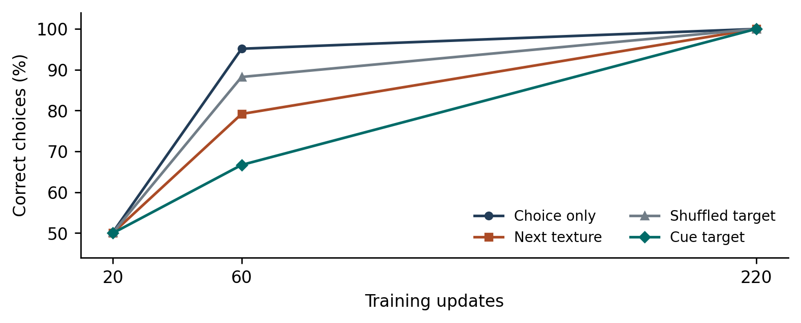

# Predicting corridor texture during delayed cue recall

A controller sees a left or right cue once, then walks past a sequence of textures before it has to choose a turn. The textures follow a learnable pattern that carries no information about the cue. Can learning to predict the next texture also help the controller remember the entrance sign?

[Read the manuscript (PDF)](manuscript.pdf) · [Read the Markdown version](manuscript.md) · [Inspect the seed-level results](results.csv)



## Experiment

The four possible textures form a cycle. From the current texture, the next is the clockwise neighbor with probability 0.8 and the counterclockwise neighbor otherwise. Each generated path appears twice, once with the left cue and once with the right. This gives a direct control for information leakage. Erasing the entrance cue makes the two inputs identical, so any deterministic classifier must get one of the two labels right.

The 12-unit recurrent network is trained under four objectives. Choice-only training predicts the turn at the end. The other objectives add a prediction of the next texture, a shuffled texture target, or a repeated copy of the entrance cue. Twelve seeds pair the initial weights and training batches across all four objectives. Every model sees delays of 2, 4 and 8 steps in training. Delays of 16 and 32 test whether the cue survives beyond the training range.

## Findings

After 220 updates, all 48 controllers made the correct choice in every tested episode at all five delays. At delay 16, the next-texture head predicted upcoming observations with 79.89% accuracy, close to the 80% expected accuracy of always choosing the clockwise successor. Erasing the cue yielded exactly 50% choice accuracy.

Once the final scores reached their ceiling, earlier checkpoints were examined. The table shows mean choice accuracy across seeds at update 60.

| Steps since cue | Choice only | Next texture | Shuffled target | Repeated cue |
| --- | ---: | ---: | ---: | ---: |
| 2 | 100.00% | 99.10% | 100.00% | 92.47% |
| 8 | 94.57% | 80.40% | 89.31% | 74.00% |
| 16 | 95.15% | 79.17% | 88.24% | 66.69% |
| 32 | 91.79% | 79.17% | 85.92% | 66.64% |

At delay 16 the paired difference between next-texture and choice-only training was −15.97 percentage points. Seven of the 12 next-texture models got all 1,024 choices right. The other five scored 512 or 513. The mean therefore conceals a sharp difference between seeds. The intermediate-checkpoint results are exploratory. Testing a preselected checkpoint on new seeds and on a generator where texture depends on the cue would help distinguish delayed optimization from an effect specific to predictable distractors.

This is a supervised symbolic sequence task with forced forward movement and one bit to retain. All timing, cues and choices are generated. Behavioral claims concern these trained networks.

## Reproduce

Run the numerical verifier first. It needs only the Python standard library.

```console
python verify.py
```

The CPU experiment was tested with Python 3.11, NumPy 1.26 and a compatible CPU build of PyTorch 2.9. From the repository root, install the research dependencies, regenerate the 720-row results file, and rerun the checks.

```console
python -m pip install -r requirements.txt
python run.py
python verify.py
```

Each row represents a seed, an objective, a test delay and a checkpoint. The verifier checks choice counts, cue-erasure counts, next-texture accuracy and the paired difference. To regenerate the figure after the experiment, run the plotting script with its additional dependencies.

```console
python -m pip install -r requirements-plot.txt
python make_figure.py
```

## Research context

The design isolates cue retention from environmental prediction in a much smaller task than full navigation. [Ororbia and Kelly on maze learning and predictive processing](https://arxiv.org/abs/2204.00619) · [Jaderberg et al. on auxiliary learning objectives](https://arxiv.org/abs/1611.05397)

Maintained by Vedant Thaker.
