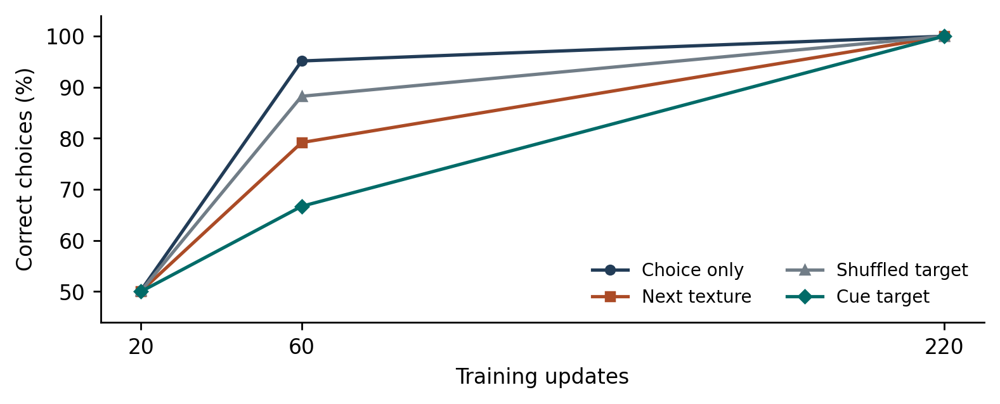
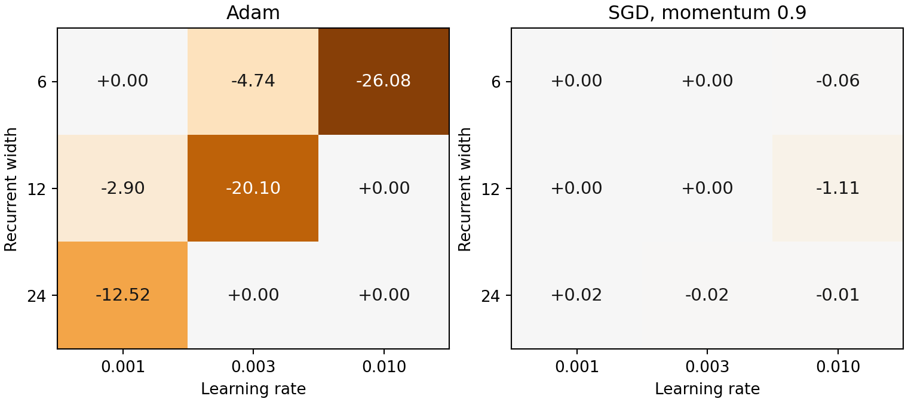

# Auxiliary texture prediction can delay early cue recall in a supervised recurrent network

**Vedant Thaker**  
Independent Researcher, Jeffersonville, Indiana, United States  
Correspondence: vthaker1@asu.edu  
21 November 2026

## Abstract

The entrance cue in a symbolic corridor determines a later choice. Its intervening textures are predictable and independent of the cue. After 220 updates, all 48 original networks recalled every tested cue. At 60 updates, adding next-texture loss reduced recall at a 16-step delay. In a publicly specified confirmation with 24 previously unused training seeds, mean recall was 93.43% with choice-only supervision and 71.31% with the added loss (paired difference −22.12 percentage points, 95% seed-bootstrap interval −32.04 to −12.50). Across 18 optimizer, learning-rate and width settings the difference ranged from −26.08 to +0.02 points. At the reference setting, gating the auxiliary loss by the sign of its encoder-gradient alignment recovered 12.01 points relative to always using the loss. On measured smartphone activity sequences the corresponding fixed auxiliary loss changed early activity accuracy by +0.94 points (−2.46 to +4.64). The effect concerns early cue retention in a specific training regime.

## Delayed choice with a predictable distractor

Jaderberg et al. used auxiliary reinforcement and prediction tasks to train agents [1], and Mirowski et al. used depth and loop-closure prediction during navigation [2]. Ororbia and Kelly studied predictive processing and associative memory in maze learning [3]. In an environment where action affects future observations, a better predictor may also help the agent gather evidence for its eventual choice. The forced corridor removes that interaction.

At the entrance a cue specifies the correct response. The subsequent texture sequence has its own predictable transitions and carries no information about the cue. This construction lets the experiment measure recall and next-symbol prediction separately. The one-bit result does not establish a mechanism of biological memory.

## Generator, counterbalancing and controls

Each observation has six channels. The first observation is a one-hot binary cue, followed by d one-hot textures drawn from a four-state cycle. The first texture is uniform. For each transition, including the symbol predicted after the last input, the next state moves clockwise with probability 0.8 and counterclockwise otherwise. Texture generation is independent of cue identity.

Every sampled trajectory appears twice with opposite cue labels in the same batch. Evaluation uses 512 independently sampled paths per training seed and delay, each paired across the two cues for 1,024 episodes. At a fixed seed and delay, all objectives and checkpoints see the same held-out examples. Sampling streams differ between training and test. At short delays, independent streams can produce identical paths. Erasing the cue makes each pair identical except for its label. A deterministic classifier must choose correctly on exactly one member of each pair.

## Learning objectives and matched training budgets

The encoder is a width-12 tanh recurrent layer with six inputs. Two linear heads produce two choice logits and four auxiliary logits. Of 318 trainable parameters, 52 belong to the auxiliary head. All variants minimize cross-entropy on the terminal choice. Three conditions add auxiliary cross-entropy, averaged across texture steps, at weight 0.5. The true-texture condition predicts the next observation. The shuffled condition permutes target trajectories across batch members. The repeated-cue condition predicts the entrance label at every step, using two of the four output classes.

Each of 12 seeds defines identical initial weights and ordered batches across all four objectives. One update contains 24 trajectory pairs at a delay sampled uniformly from 2, 4 and 8 steps. Adam uses learning rate 0.003 and gradient clipping at norm one. Training ends at 220 updates. Evaluation includes delays 2, 4, 8, 16 and 32 at updates 20, 60 and 220. Equal updates give equal data exposure, although the auxiliary objectives require additional computation.

## Original training trajectories

After 220 updates, all 240 seed–objective–delay cells had 1,024 correct choices. Cue erasure yielded exactly 512 correct throughout. At delay 16, the trained next-texture head reached 79.89% accuracy, close to the generator’s 80% optimal expected one-step accuracy. The untrained auxiliary head under choice-only training scored 24.92%. These measurements establish recall and texture prediction on the tested sample and lengths.

The original early checkpoints were inspected after the ceiling was observed. At update 60 and delay 16, seven of the 12 texture-supervised models got all 1,024 choices right, four got 512, and one got 513. Their 79.17% mean masks this separation across seeds. Choice-only training averaged 95.15%. The paired texture-minus-choice difference from unrounded counts was −15.97 percentage points (20,000-resample seed bootstrap interval −28.62 to −3.73). This interval was exploratory across the inspected checkpoints and delays.

At update 20 and delay 16 all objectives remained between 50.00% and 50.22%. At delay two, choice-only and next-texture accuracy were already 81.66% and 71.00%. The next-texture head’s own accuracy at delay 16 reached 58.89% by update 60. Neither the intermediate choices nor the texture predictions can be recovered from the final choice ceiling alone.

| Delay | Choice only | Texture | Shuffled | Repeat cue |
| --- | --- | --- | --- | --- |
| 2 | 100.00 | 99.10 | 100.00 | 92.47 |
| 4 | 100.00 | 87.80 | 98.86 | 87.72 |
| 8 | 94.57 | 80.40 | 89.31 | 74.00 |
| 16 | 95.15 | 79.17 | 88.24 | 66.69 |
| 32 | 91.79 | 79.17 | 85.92 | 66.64 |

Table 1. Mean choice accuracy (%) after 60 updates on the original 12 seeds. Delays 16 and 32 were held out from training.

Figure 1. Mean recall at delay 16 on the original 12 paired seeds. Each point is a measured checkpoint. All four conditions reach the ceiling by update 220.

## Previously reported independent seed block

The November 20 extension fixed a single primary endpoint before computing the new results: percentage-point change in recall at update 60, delay 16, for a next-texture loss of weight 0.5. Its locally recorded analysis plan was recorded before training on seeds 1000–1023. At each seed, choice-only and all three texture weights used paired initial weights, training trajectories and held-out examples. Intervals use 20,000 percentile bootstrap resamples of whole paired seeds. Additional loss weights are descriptive.

Ten of 24 seeds had worse recall with the primary weight, 14 tied and none improved. The −12.02-point paired estimate corroborates the direction of the original comparison for this generator. At weight 0.125 only two seeds differed from control. At 2.0, twenty had lower recall. These three settings show that a conclusion about auxiliary learning at weight 0.5 transfers poorly across even this limited range of weights.

| Weight | Cue recall with texture loss (%) | Difference, pp | 95% interval, pp |
| --- | --- | --- | --- |
| 0.125 | 96.22 | −0.06 | −0.16 to 0.00 |
| 0.5 (primary) | 84.27 | −12.02 | −19.96 to −4.96 |
| 2.0 | 61.27 | −35.01 | −43.69 to −25.81 |

Table 2. Fresh-seed recall at 60 updates and delay 16. Choice-only accuracy averaged 96.28%. Intervals refer to variation across paired seeds.

## Registered confirmation on a separate block of 24 seeds

The original 12-seed exploration and the November 20 extension were known when the November 21 designs were specified. First, a local plan fixed a parameter sweep using seeds 2000–2011 and a separate measured-task comparison. The GitHub copy of this plan was posted during the extension. A distinct confirmatory plan was posted publicly before any fits on seeds 4000–4023. It fixed update 60, evaluation delay 16, Adam at 0.003, width 12, auxiliary weight 0.5, and a single contrast of fixed next-texture versus choice-only supervision. Its upper 95% interval endpoint had to fall below zero to support a directional cost. All 24 paired seeds were retained.

On these held-out seeds, early cue recall fell from 93.43% to 71.31%. The paired difference was −22.12 points (95% percentile interval −32.04 to −12.50, 20,000 paired-seed resamples with random seed 42117). Thirteen seeds lost accuracy, ten tied and one improved. The upper endpoint met the registered rule. This interval quantifies training-seed and sampled-path variability under this generator. It does not cover changes of architecture, learning rate or task.

## How the early effect varies with optimization

The local-plan sweep crossed widths 6, 12 and 24 with learning rates 0.001, 0.003 and 0.01 and two optimizers, Adam and SGD with momentum 0.9. For each of 18 cells, twelve paired seeds ran three modes to update 60: choice only, fixed next-texture loss, and a gradient-gated next-texture loss. Every comparison used the same data exposure and delay-16 test. The sweep is descriptive; intervals across its contrasts were not multiplicity adjusted.

The largest mean fixed-loss deficit was 26.08 points (width six, Adam at 0.01; 100.00% control vs 73.92% with texture). At width 24, Adam at 0.003, both conditions already had perfect recall. Several SGD settings left both near chance; at width 12 and 0.003, both averaged 50.00%. Equality at either boundary leaves little information about interference. These are early-budget comparisons without separate optimizer tuning.

Figure 2. Mean fixed-texture minus choice-only recall at update 60 and delay 16, in percentage points, for each of 18 settings. Each cell uses 12 paired seeds.

## Shared gradients and a conditional auxiliary loss

For every update, the gradients of choice loss and unweighted texture loss were calculated separately on the shared encoder, before combination and norm clipping. Their cosine is the dot product divided by the product of the two norms, with a numerical floor of 10⁻¹² per norm. Following the gradient-similarity idea of Du et al. [4], the gated mode used auxiliary weight 0.5 only when the cosine was positive. Otherwise the update used the choice loss alone. This binary gate on the whole auxiliary loss is one implementation of the idea.

In the reference sweep cell (Adam at 0.003, width 12), mean recall was 99.27% for choice-only, 79.17% for fixed weight and 91.18% for the gate. The gate recovered 12.01 points vs fixed (paired interval 0.46 to 24.28); it remained 8.09 points below choice-only (−18.69 to −0.02). Under fixed weight the raw encoder gradients had negative cosine on 80.0% of updates (mean −0.172). Under the gate the fraction was 75.4% (mean −0.108). Negative cosines were also frequent in a ceiling cell: at width 12, Adam 0.01, fixed-weight gradients were opposed on 89.2% of updates, despite 100% recall in both conditions. Alignment alone cannot predict a deficit at the evaluated checkpoint.

## Transfer check on measured activity sequences

The UCI Human Activity Recognition Using Smartphones dataset contains 128-sample windows from 30 participants performing six labeled activities [5]. The official train and test sets contain 7,352 windows from 21 participants and 2,947 from nine disjoint participants. The benchmark retained the x, y and z channels of total acceleration, subsampled samples 0, 4, …, 124, and standardized channels using training data only. A width-12 tanh encoder classified activity at the last of 32 steps. Auxiliary supervision predicted the next three acceleration values by mean squared error over the 31 valid transitions; the corridor auxiliary used cross-entropy.

Eight paired seeds 3000–3007 received 60 Adam updates (learning rate 0.003, batch 48). The same three modes shared the held-out windows at each pair. Fixed weight gave 43.24% versus 42.30% for classification alone, a difference of +0.94 points (−2.46 to +4.64). Gating gave 42.27%, a −0.03-point contrast with control (−3.59 to +4.00). The two raw task gradients had negative cosine on 62.3% of fixed-weight updates. The sign of the corridor result did not recur clearly here: labels and sensor dynamics share information, loss scales differ, and the budget is deliberately short. Intervals pair training seeds on one fixed subject split, not on resampled participants.

## Interpretation

At the reference width, learning rate and budget, auxiliary texture prediction can slow early acquisition of an independently cued decision. Counterbalancing fixes erased-cue accuracy at 50% and rules out information about the required choice in the texture sequence. The gate partly reduced the early deficit without isolating a unique mechanism: clipping, gradient direction, number of auxiliary updates and the dynamics of Adam all change or interact along the training path.

Three tested recurrent widths and two optimizers constrain claims about robustness. All original models reached the later ceiling, and a real-signal task did not show a clear deficit. A causal test of representation competition would vary the cue dependence of sensory transitions, compare gates with matched random update suppression, and measure cue decodability from internal state.

## Data and code availability

The baseline repository contains the original training program and its standard-library verifier. The supplement contains the earlier seed extension and its locks, the new experiment code, per-seed scores, per-update alignments and the scored confirmation. Commands appear in README.md. The public confirmatory plan is at https://github.com/VEDANT1602/delayed-cue-recall/blob/ae1c428475388cee0045d20cdd02f8e175da67cb/revision/confirmatory-plan.md.

[Pinned baseline](https://github.com/VEDANT1602/delayed-cue-recall/tree/686f4f7e50229f061b4efdc5cb5d3f4812a2fc48) · [Revision code and data](https://github.com/VEDANT1602/delayed-cue-recall/tree/main/revision/supplement) · [Preparation record](https://github.com/VEDANT1602/delayed-cue-recall/blob/main/revision/PREPARATION.md)

## Computational verification

The 720-row baseline replay matched all original choice and erasure counts. One prediction from an untrained auxiliary head differed by a single symbol in 16,384, as detailed in the previous replication record. The extension ran 648 sweep fits, 24 activity fits and a separately registered 48 confirmatory fits on CPU. Per-seed and per-update records document the grouping and the accuracy denominators. Reference software and supplementary scripts specify the dependency versions.

## Author contribution

Vedant Thaker is the sole author. He designed the original delayed cue-recall study, wrote its manuscript, developed its original software, and requested the comparisons and checks reported in this revision.

## Use of computational assistance

OpenAI Codex assisted with the original rerun, new-seed training, registered confirmation, optimizer and gradient-gating comparisons, and analysis of the UCI activity benchmark, as well as literature checks and preparation of the revised text. The author set the research question and requested the revision.

## Funding

This research received no specific grant from any funding agency in the public, commercial, or not-for-profit sectors.

## Competing interests

The author declares no competing interests.

## References

[1] M. Jaderberg, V. Mnih, W. M. Czarnecki, T. Schaul, J. Z. Leibo, D. Silver and K. Kavukcuoglu. Reinforcement learning with unsupervised auxiliary tasks. ICLR (2017). https://arxiv.org/abs/1611.05397

[2] P. Mirowski et al. Learning to navigate in complex environments. ICLR (2017). https://arxiv.org/abs/1611.03673

[3] A. Ororbia and M. A. Kelly. Maze learning using a hyperdimensional predictive processing cognitive architecture. Artificial General Intelligence (AGI 2022), LNCS 13539, 321–331 (2023). https://doi.org/10.1007/978-3-031-19907-3_31

[4] Y. Du, W. M. Czarnecki, S. M. Jayakumar, M. Farajtabar, R. Pascanu and B. Lakshminarayanan. Adapting auxiliary losses using gradient similarity. arXiv:1812.02224 (2018, revised 2020). https://arxiv.org/abs/1812.02224

[5] J. Reyes-Ortiz, D. Anguita, A. Ghio, L. Oneto and X. Parra. Human Activity Recognition Using Smartphones [dataset]. UCI Machine Learning Repository (2013). https://doi.org/10.24432/C54S4K
